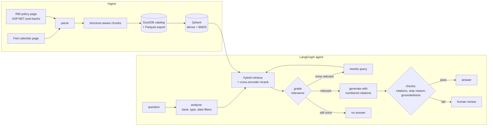

# central-bank-rag

Question answering over US Federal Reserve and Reserve Bank of India monetary policy documents,
with cited answers and a check on every answer before it is shown.

```text
$ cbrag search "When was the standing deposit facility introduced and at what rate?" --k 1

#1 rbi-governor_statement-20220608  Liquidity and Financial Market Guidance
15. I would now like to touch upon liquidity and financial market conditions. It may be recalled
that in April we introduced the Standing Deposit Facility (SDF) as the floor of the liquidity
adjustment facility (LAF) corridor at an interest rate of 3.75 per cent. ...
```

`cbrag ask` runs the full agent on top of this: it grades the passages, answers with numbered
citations, checks the answer and withholds anything it cannot support.

## What it covers

| Bank | Documents | From |
|---|---|---|
| Federal Reserve | FOMC statements, minutes, press conference transcripts | Jan 2021 |
| Reserve Bank of India | MPC resolutions, minutes, Governor's statements, press conference transcripts | Feb 2021 |

280 documents and about 9,900 passages; `cbrag stats` prints the current numbers. New meetings
are picked up by re-running `cbrag ingest && cbrag index`, which only downloads and embeds what
is new.

## How it works



1. **Sources** (`sources/fed.py`, `sources/rbi.py`). The Fed's calendar page links each
   meeting's statement, minutes and press-conference transcript (PDF). The RBI's policy page is an
   ASP.NET WebForms page: earlier years only appear after a form post-back, which the RBI source
   replays. Every download is cached on disk, so re-runs are offline and polite to both servers.
2. **Parsing and chunking** (`parsing/`, `chunking.py`). Minutes keep their section headings;
   transcripts are split into speaker turns, and short turns (a reporter's question) are folded
   into the answer that follows. Chunks never cross a heading or a change of speaker.
3. **Storage**. Parsed documents and chunks go into a DuckDB catalog (`catalog.sql`), which is
   also where evaluation results are stored. Qdrant holds a dense vector (`bge-small-en-v1.5`)
   and a BM25 sparse vector per chunk. Indexing is incremental: a content hash per chunk means
   only new or edited chunks are re-embedded.
4. **Retrieval** (`retrieval/`). Bank, document type and dates stated in the question become hard
   filters; dense and BM25 results are merged with reciprocal rank fusion and the top 30 are
   reranked by a cross-encoder that sees each passage's bank, type and date along with its text.
5. **Agent** (`agent/`). A LangGraph state graph grades the retrieved passages, rewrites the query
   once if nothing is relevant, writes an answer that cites passage numbers, and checks it:
   refusal or truncation, missing or invented citations, then a model-based groundedness check.
   Anything that fails goes to human review, either a queue file or a paused run (LangGraph
   `interrupt`) that a reviewer resumes with approve, edit or reject. Runs are checkpointed to
   SQLite, so a paused review survives a restart.
6. **Models** (`llm/`). One small interface with Claude, OpenAI and Ollama behind it; the provider
   is a setting. Claude calls use server-side refusal fallbacks.

## Results

Retrieval on the 47 answerable questions in `eval/golden.jsonl` (a passage counts as relevant when
it comes from the right document and contains the evidence string):

| Variant | hit@1 | hit@5 | MRR@10 | nDCG@5 | doc recall@5 |
|---|---|---|---|---|---|
| dense only (bge-small) | 0.17 | 0.32 | 0.24 | 0.24 | 0.44 |
| BM25 only | 0.34 | 0.55 | 0.44 | 0.46 | 0.52 |
| hybrid (RRF) | 0.21 | 0.55 | 0.36 | 0.40 | 0.55 |
| hybrid + metadata filters | 0.45 | 0.77 | 0.61 | 0.63 | 0.82 |
| **hybrid + filters + cross-encoder rerank (default)** | **0.49** | **0.81** | **0.63** | **0.66** | **0.81** |
| hybrid + filters, BGE query instruction | 0.43 | 0.74 | 0.60 | 0.62 | 0.80 |

Two findings. Metadata filters (bank, document type and dates read from the question) are the biggest
single gain: statements from different meetings are near-identical, so dates have to be enforced
rather than left to similarity. And the cross-encoder initially made results worse (hit@5 0.72 to
0.62) because it scored passage text alone and could not tell one meeting's boilerplate from
another's; scoring the provenance header (bank, type, date) with the text turned it into a small
gain. With 47 questions, differences under about 10 points are within noise.

The full agent is scored by `cbrag eval answer` (answered rate, exact-fact correctness, citation
precision, abstention on the 5 unanswerable questions). It calls a hosted model, so it is not run
in CI; see `docs/evaluation.md` for the method.

## Quick start

```bash
python -m venv .venv && source .venv/bin/activate   # Windows: .venv\Scripts\activate
pip install -e ".[dev]"
cp .env.example .env                                  # add an API key for the provider you use

cbrag ingest        # download and parse (about 10 minutes the first time)
cbrag index         # embed (CPU, a few minutes; models download on first use)
cbrag ask "What did Powell say about tariffs in May 2025?" --show-trace
```

Other entry points:

```bash
cbrag search "standing deposit facility" --k 5      # retrieval only, no API key needed
cbrag serve                                         # HTTP API on :8000 (POST /ask, GET /search)
cbrag mcp                                           # MCP server over stdio
cbrag eval retrieval                                # retrieval benchmark, writes docs/results/
docker compose up --build                           # API + Qdrant server
```

### Using it from an MCP client

```json
{
  "mcpServers": {
    "central-bank-rag": { "command": "cbrag", "args": ["mcp"], "cwd": "/path/to/central-bank-rag" }
  }
}
```

`search_policy_documents` needs no API key: the client's own model reads the passages.
`ask_policy_question` runs the full agent.

## Project layout

```text
src/policyrag/
  sources/       Fed and RBI discovery, download cache, parsers
  parsing/       text clean-up, dates, transcript speaker turns
  chunking.py    structure-aware chunking
  catalog.py     DuckDB catalog (+ catalog.sql schema and views)
  index/         embeddings, Qdrant collection, incremental sync
  retrieval/     query filters, hybrid retrieval, reranking
  llm/           provider interface: anthropic, openai, ollama, fake
  agent/         LangGraph state, nodes, graph, prompts, service facade
  eval/          metrics and evaluation runner
  api/           FastAPI app
  mcp_server.py  MCP tools
  cli.py         `cbrag` command
eval/golden.jsonl   52 questions with gold documents and evidence strings
tests/              unit tests (no network, no models) and golden-set checks
```

## Development

```bash
make lint     # ruff + mypy --strict
make test     # pytest, offline
```

## Limitations

* English documents only; RBI's Hindi versions are not ingested.
* The rule-based filter parser handles common phrasings ("June 2024", "since 2023", "minutes");
  unusual date expressions fall back to unfiltered search.
* Tables in minutes (projections) are flattened to text, which loses their structure.
* Answer quality depends on the configured model; the groundedness check uses the same model.

## Licence

MIT. Source documents are public releases of the Federal Reserve and the Reserve Bank of India.
